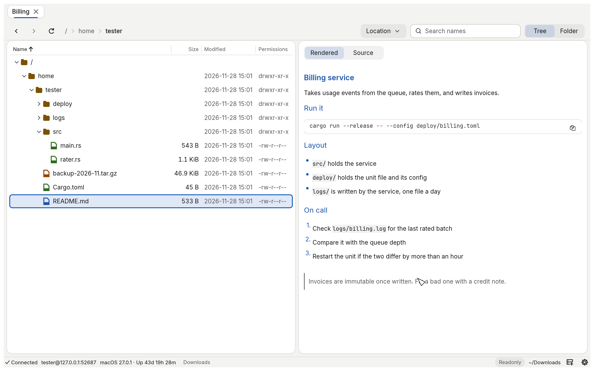
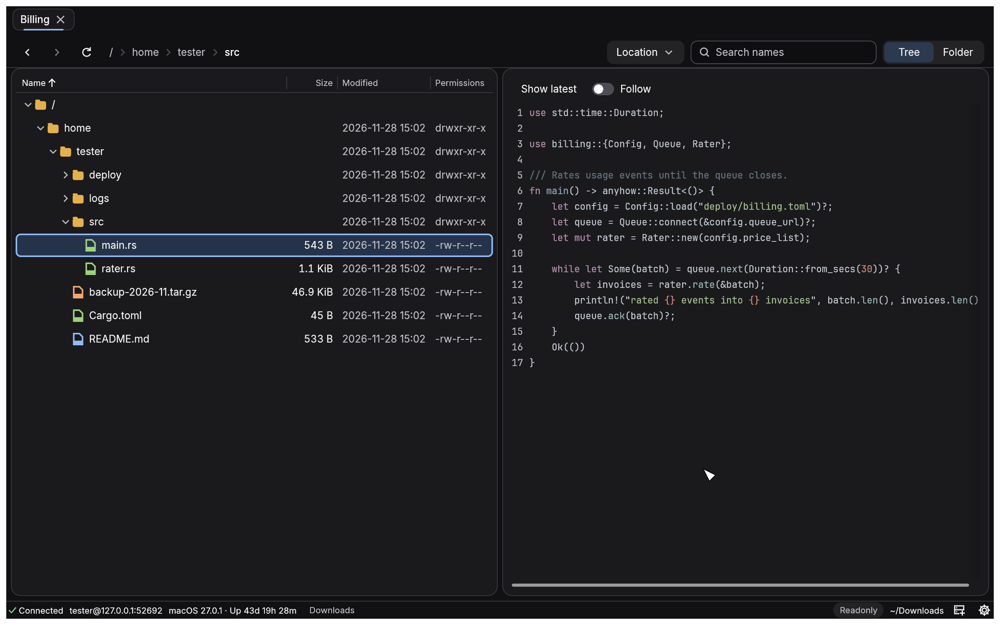
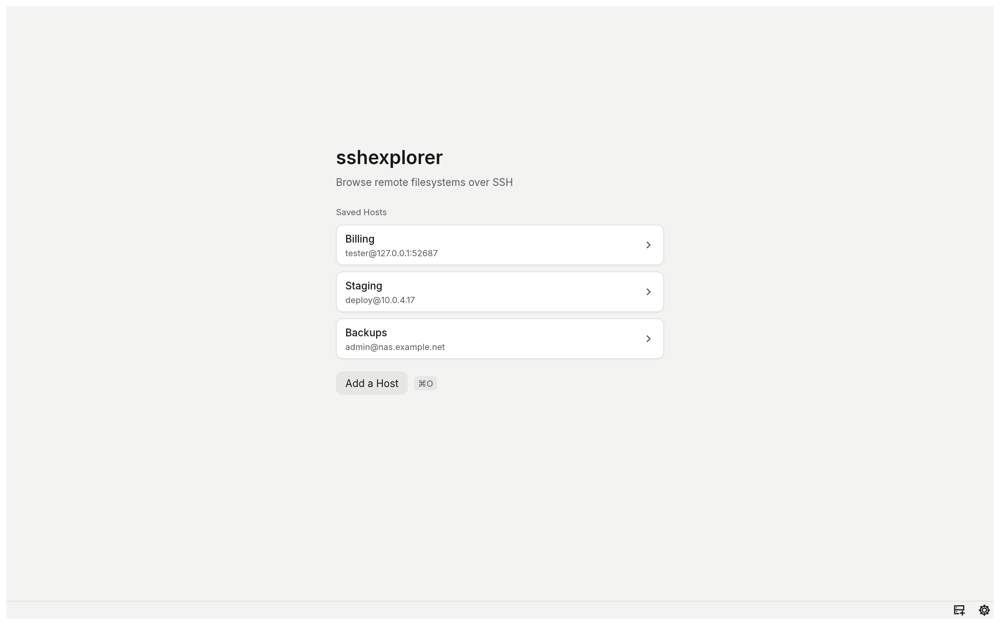

# sshexplorer

A desktop app for browsing a remote server's files over SSH, and reading them without downloading them first.



sshexplorer runs on Linux, macOS and Windows and connects to hosts running Linux, macOS or a BSD. It uses your existing `~/.ssh/config`, `known_hosts`, keys and SSH agent, and needs nothing installed on the host.

Site: <https://mnj.github.io/sshexplorer/>

## What it does

- **Tree view and Folder view.** Browse the whole filesystem as an expandable tree, or one directory at a time. Each Session is a tab with its own connection.
- **Preview.** Focus a file to see it beside the listing: text, source with syntax highlighting, rendered Markdown, images, PDF, archive listings, audio and video. Log files can be followed as they grow.
- **Search.** Find files and directories by name, run on the host from the directory you are in.
- **Download.** Copy a Selection, directories included, into the Host's local folder. Several files transfer at once, and large text files can be compressed with `zstd` when the host has it.
- **Readonly by default.** A new Host is readonly: its Sessions cannot change the remote filesystem.
- **Saved Hosts.** Keep the hosts you use, pin folders on them, and open one from the welcome screen with a click. A password or key passphrase can be remembered in the OS credential store.
- **Reconnect.** A dropped connection keeps its tab and its listings, and reconnects by itself.
- **Yours to tune.** Light and dark, an accent colour, two densities, UI scale, fonts, and every key binding.

| | |
|---|---|
|  |  |
| Source Preview, dark | Saved Hosts at launch |

## Build and run

There are no packaged releases yet. sshexplorer is a Rust crate, and audio and video Preview links against GStreamer.

On macOS:

```sh
brew install gstreamer pkgconf
cargo run --release
```

On Debian or Ubuntu:

```sh
sudo apt-get install pkg-config libgstreamer1.0-dev libgstreamer-plugins-base1.0-dev \
  gstreamer1.0-plugins-base gstreamer1.0-plugins-good gstreamer1.0-libav
cargo run --release
```

[docs/building.md](docs/building.md) has Fedora, Arch and Windows, and what each GStreamer plugin set is needed for.

## Limits

- A Session that needs `ProxyJump` or `ProxyCommand` does not open.
- Sessions browse and download. They do not upload, rename or delete yet.
- Search matches names, not file contents.

## For contributors

- [GLOSSARY.md](GLOSSARY.md) defines the words the code and the UI use: Host, Session, Preview, Selection and the rest.
- [docs/adr/](docs/adr/) records the decisions behind the SSH stack, the styling rules and the media stack.
- `cargo test` runs the suite. It starts its own SSH server and touches none of your SSH files.

## Licence

MIT. See [LICENSE](LICENSE). The bundled Inter and JetBrains Mono fonts are under the SIL Open Font License; see [fonts/](fonts/).
